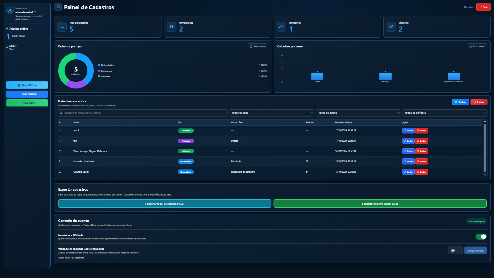
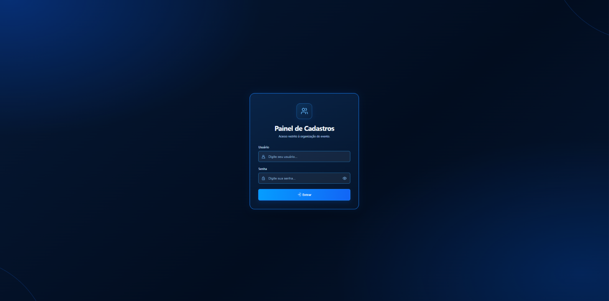
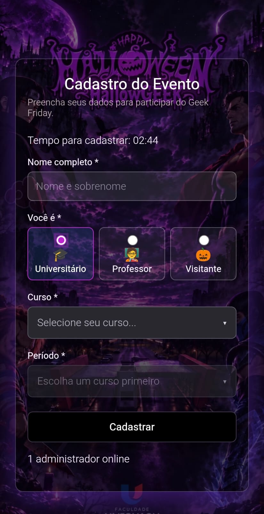
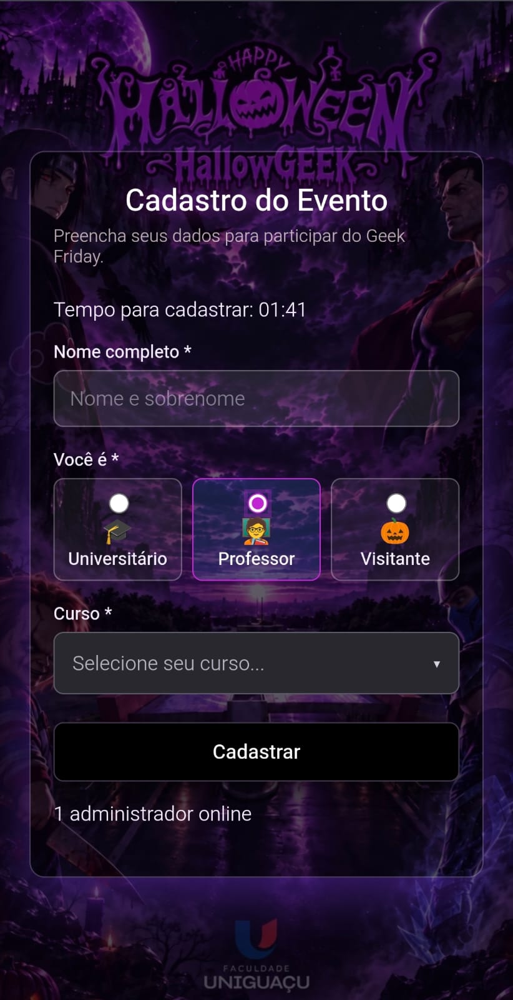
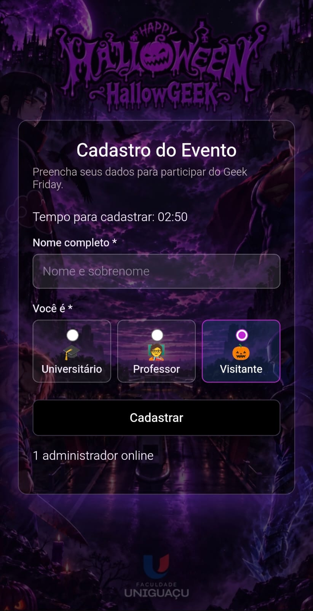
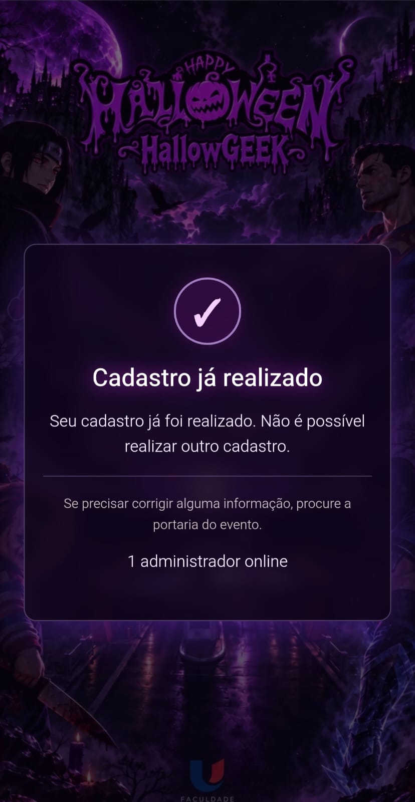

# 🎃 App Geek — Sistema de Inscrições para Eventos

Sistema web full-stack desenvolvido para gerenciar inscrições em eventos acadêmicos, utilizando QR Code dinâmico, autenticação de administradores e banco de dados PostgreSQL.

**Tecnologias:** Next.js • React • TypeScript • Node.js • PostgreSQL

## 🖥️ Visão geral



O App Geek permite gerenciar participantes, acompanhar estatísticas em tempo real, configurar inscrições e exportar os dados do evento.

### Principais funcionalidades

- QR Code dinâmico com validade configurável
- Cadastro de universitários, professores e visitantes
- Painel administrativo com gráficos e filtros
- Administradores online e controle de permissões
- Exportação de cadastros em CSV
- Backup e limpeza protegida dos dados
- Interface responsiva para computadores e celulares

### Fluxo do evento

```text
Administrador faz login → abre o QR em uma nova guia
         ↓
Participante escaneia → /entrar valida QR → 3 minutos para preencher
         ↓
Cadastro → regras de curso/período e duplicidade → PostgreSQL
         ↓
Painel: gráficos, busca, edição, exportação CSV e encerramento do evento
```

## Tecnologias

| Camada | Ferramentas |
|---|---|
| Aplicação | Next.js 15, React 19, TypeScript |
| API | Next.js Route Handlers (Node.js) |
| Banco | PostgreSQL, `pg`, migrações SQL |
| Autenticação | `scrypt`, sessões no PostgreSQL e cookies HTTP-only |
| QR | Biblioteca `qrcode` e tokens temporários |
| Testes | Node.js Test Runner |

## Instalação em ambiente de demonstração

**Requisitos:** Node.js 22, npm e PostgreSQL. **Não use o banco ou as credenciais da instalação real do evento.**

1. Clone seu fork/repositório e instale:

   ```bash
   git clone https://github.com/SEU-USUARIO/app-geek-portfolio.git
   cd app-geek-portfolio
   npm ci
   ```

2. Crie um banco PostgreSQL **novo e vazio**, por exemplo `app_geek_demo`. No terminal PostgreSQL (ou no pgAdmin):

   ```sql
   CREATE DATABASE app_geek_demo;
   ```

3. Copie o modelo de ambiente:

   ```powershell
   Copy-Item .env.example .env.local
   ```

   Em Linux/macOS: `cp .env.example .env.local`.

4. No `.env.local`, preencha `DB_HOST`, `DB_PORT`, `DB_USER`, `DB_PASSWORD`, `DB_NAME=app_geek_demo` e `PUBLIC_URL=http://localhost:3000`. Gere **duas chaves diferentes**, executando o comando abaixo duas vezes:

   ```bash
   node -e "console.log(require('crypto').randomBytes(32).toString('hex'))"
   ```

   Cole os resultados em `APP_SECRET` e `DEVICE_COOKIE_SECRET`. Crie uma senha forte para `BOOTSTRAP_ADMIN_PASSWORD` (**12 caracteres ou mais**). Todos esses valores são **privados**, usados só no `.env.local`.

5. Crie as tabelas e a conta master (`admin`) no **banco de demonstração**:

   ```bash
   npm run db:migrate
   npm run admin:bootstrap
   ```

   O bootstrap **não redefine senhas existentes**. Remova `BOOTSTRAP_ADMIN_PASSWORD` do `.env.local` depois do primeiro uso.

6. Inicie e abra o login:

   ```bash
   npm run dev
   ```

   **http://localhost:3000/login**. O QR estará em `/qr`, e o painel em `/admin`. A rota `/cadastro` exige uma sessão QR válida para gravar um novo registro.

> Em caso de `Cannot find module 'typescript'`, rode `npm install --include=dev`. Para banco remoto, configure TLS válido; o projeto aceita `DB_SSL=true` e `DB_CA_CERT_BASE64` para CA pública. Não desative a verificação de certificados.

## Testes

```bash
npm run test:logic
npm run typecheck
npm run build
```

Os testes de lógica podem ser executados sem um banco real; os fluxos de cadastro e autenticação completos exigem um PostgreSQL de testes.

## Estrutura

```text
src/app/           → páginas e APIs do App Router
src/components/    → painel, QR, formulários e controles
src/lib/           → autenticação, segurança, QR, exportações e DB
sql/               → estrutura e migrações 001, 002 e 003
scripts/           → migração, bootstrap e restauração de backup
public/            → assets do formulário
tests/             → testes automatizados
docs/              → arquitetura, privacidade e publicação
```

## Segurança e privacidade

- O **master é um papel no PostgreSQL**, não somente uma condição visual no React. Operações destrutivas exigem autorização na API e confirmação adicional.
- O backup JSON pode conter **dados pessoais, hashes e sessões**: nunca coloque um backup real em issues, commits, prints públicos ou neste repositório. Ele não substitui um backup PostgreSQL integral (`pg_dump`).
- O bloqueio por cookie **não identifica de forma absoluta um dispositivo físico**; limpeza de cookies e outros navegadores limitam essa proteção. Nome + tipo pode ter falsos positivos para homônimos.
- Esta é uma cópia de portfólio do código. Não está configurada como uma demonstração pública com banco; rodar no GitHub **não hospeda** a aplicação.
- Antes de qualquer publicação na internet, revise limites de acesso, privacidade (LGPD), segurança e carga.

Consulte [SECURITY.md](SECURITY.md) e [docs/ARQUITETURA.md](docs/ARQUITETURA.md).

## Para apresentar o projeto

- [Guia para publicar no GitHub sem afetar o Netlify](docs/PUBLICAR-NO-GITHUB.md)
- [Texto sugerido para o LinkedIn](docs/LINKEDIN.md)
- [Como preparar capturas com dados fictícios](docs/CAPTURAS-DE-TELA.md)

**Licença:** a definir pelo titular do projeto. Publicar o código não concede automaticamente permissão de reutilização.

## 📸 Demonstração do sistema

### Painel administrativo


### Tela de login


### QR Code dinâmico


### Cadastro de universitário


### Cadastro de professor


### Cadastro de visitante


### Proteção contra cadastros duplicados
