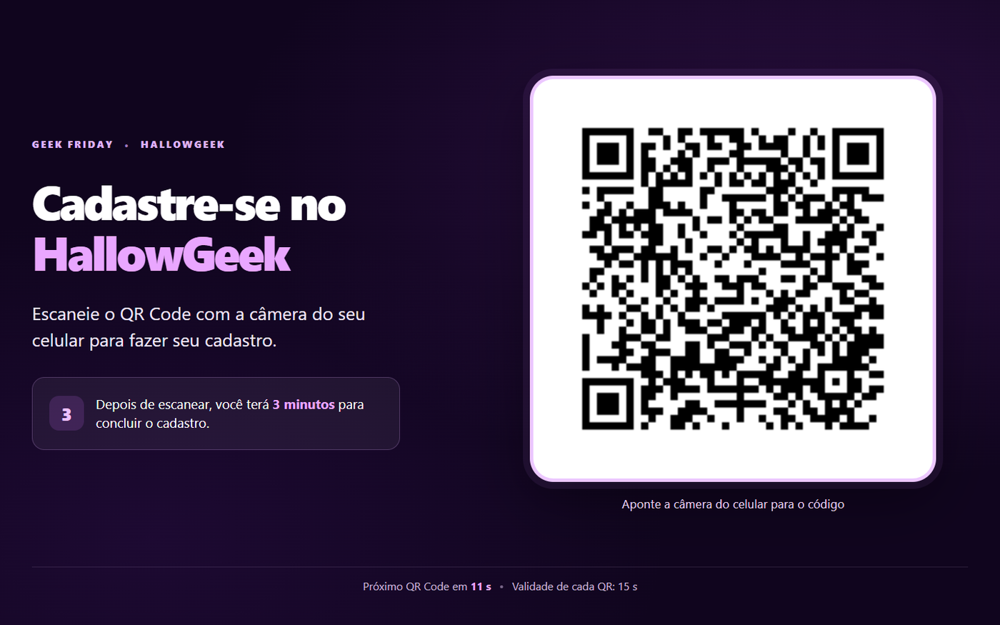
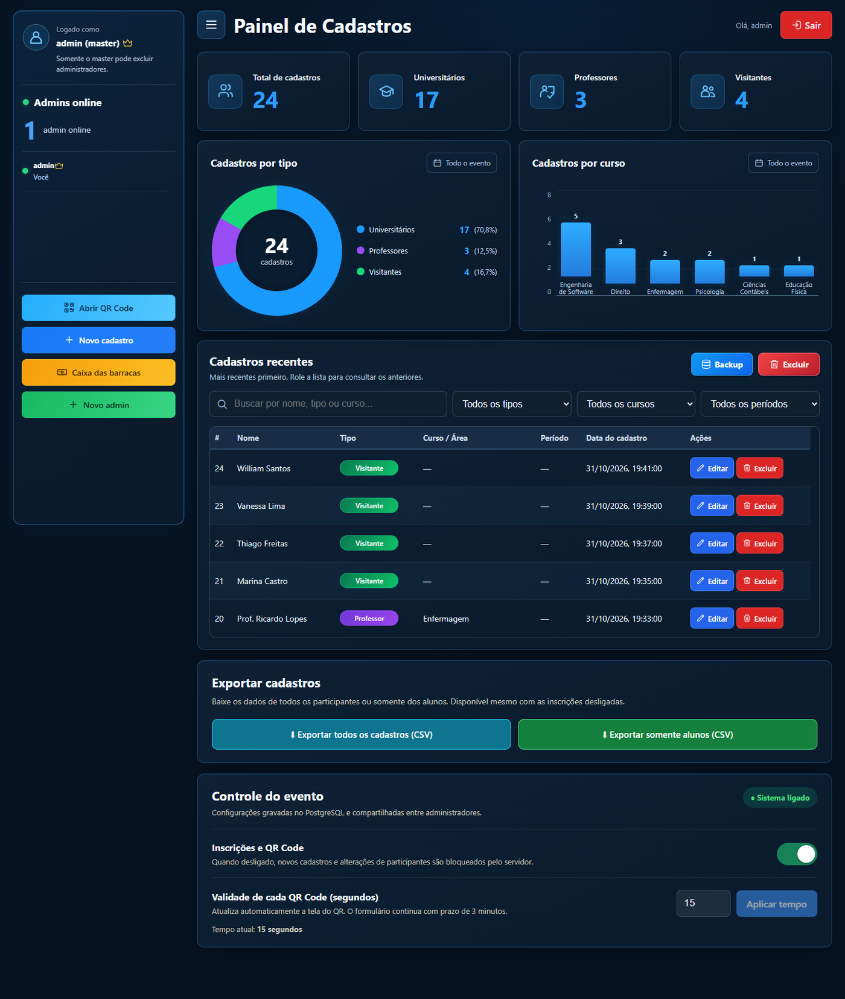
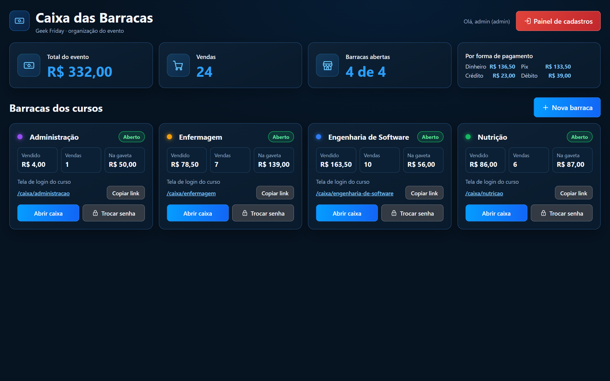
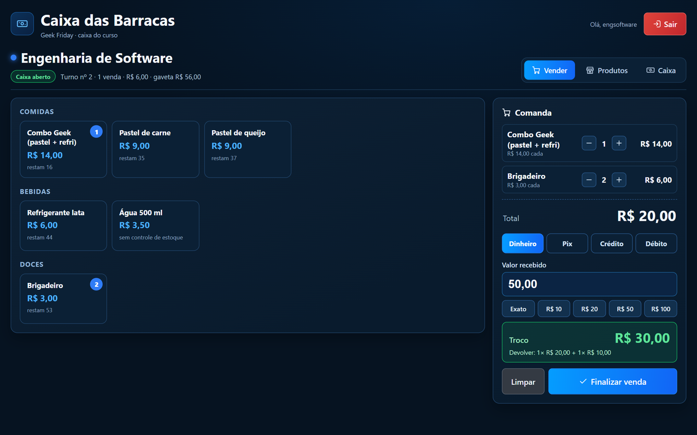
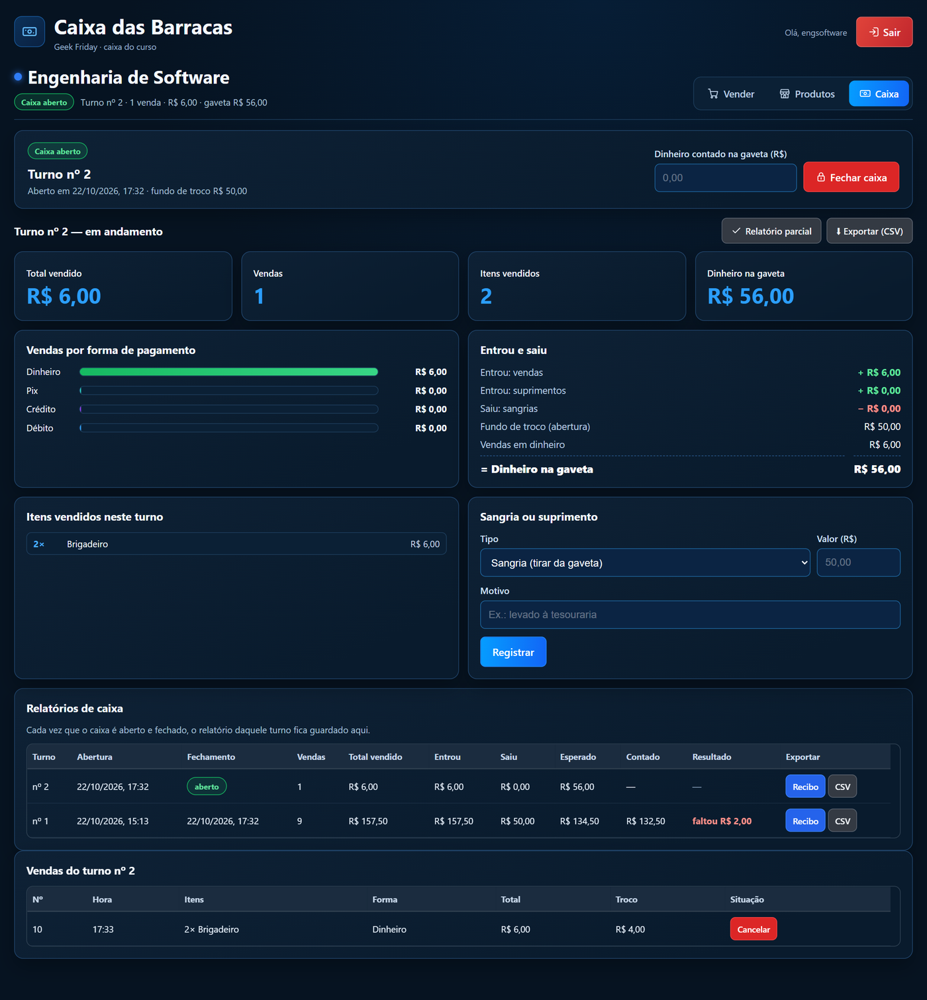
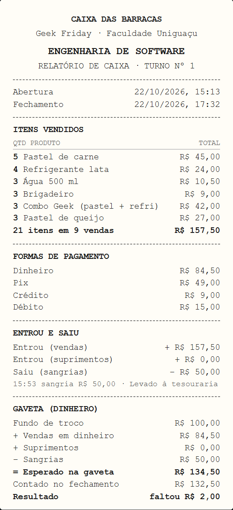
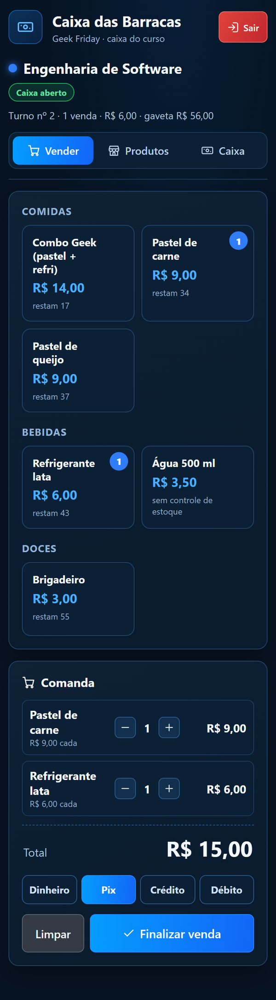
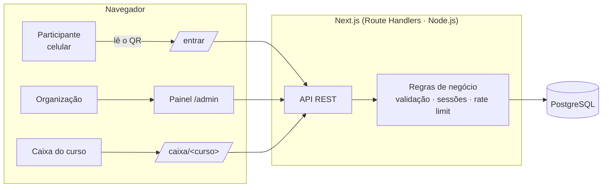

# App Geek — inscrições por QR Code e caixa das barracas para eventos acadêmicos

Sistema web full-stack criado para o **Geek Friday / HallowGeek** da Faculdade Uniguaçu. Ele resolve dois problemas do evento:

1. **Saber exatamente quem passou pelo evento:** a inscrição é feita pelo celular, lendo um QR Code que muda sozinho. Esses registros servem de base para emitir certificados com horas para os alunos.
2. **Controlar as vendas das barracas dos cursos:** cada curso tem o seu caixa (PDV). Ele registra vendas, calcula o troco, abre e fecha turnos e emite um relatório em formato de recibo.

> 🔒 **O código-fonte é privado.** Esta página apresenta o projeto: telas, arquitetura, decisões técnicas, requisitos e testes. Posso mostrar o código em entrevista.

---

## Telas

### Inscrição do participante

| QR Code dinâmico (telão do evento) | Cadastro no celular |
|---|---|
|  |  |

O QR é trocado de tempos em tempos. Depois de lido, a pessoa tem 3 minutos para concluir o cadastro, e cada aparelho só cadastra uma vez.

### Painel da organização

O painel mostra indicadores em tempo real, gráficos por tipo de participante e por curso, além de busca e filtros. Também permite editar cadastros, exportar CSV, fazer backup, ligar ou desligar as inscrições e ajustar a validade do QR.
*(Dados de demonstração. Os nomes são fictícios.)*

### Módulo Caixa das Barracas

| Escolha do curso | Central da organização |
|---|---|
|  |  |

**Venda, com comanda e troco sugerido em notas:**

**Turno de caixa:** abertura com fundo de troco, sangria e suprimento, fechamento com conferência da gaveta e relatórios guardados por turno.

| Recibo do turno (imprimir/PDF) | No celular |
|---|---|
|  |  |

---

## Funcionalidades

**Inscrições**
- QR Code dinâmico com validade configurável e token temporário assinado.
- Cadastro de universitários (curso e período), professores e visitantes.
- Bloqueio de cadastro duplicado por aparelho.
- Painel com gráficos, busca, filtros, edição e exportação CSV.
- Vários administradores, com indicação de quem está online e um administrador *master*.
- Backup e limpeza protegida dos dados ao fim do evento.

**Caixa das Barracas**
- Login próprio para cada curso, com um link exclusivo para cada barraca.
- Cadastro de produtos com categoria, estoque opcional e opção de pausar a venda.
- Venda em dinheiro, Pix, crédito ou débito. O troco aparece com sugestão de notas.
- Turnos de caixa com fundo de troco, sangria e suprimento. No fechamento, o sistema calcula o esperado, recebe o valor contado e mostra a diferença.
- Relatório de cada turno no formato de recibo (imprimir ou PDF) e exportação CSV compatível com o Excel.
- Central da organização com o total do evento, as vendas por forma de pagamento e a situação de cada barraca.

## Arquitetura

- **Front e back no mesmo projeto Next.js (App Router).** As páginas são componentes React e a API usa Route Handlers.
- **O servidor é a fonte da verdade.** Preço, total, troco, estoque e saldo da gaveta são recalculados no servidor, com os dados do banco. O valor enviado pela tela nunca é usado.
- **Dinheiro guardado em centavos (inteiros)**, para não ter erro de arredondamento. Venda, baixa de estoque e movimento de caixa são gravados juntos, numa única transação.
- **Migrações SQL versionadas.** Por exemplo, um índice único parcial garante só um turno aberto por barraca.

## Segurança

- Senhas guardadas com hash **scrypt**. As sessões ficam no banco, com **cookies HTTP-only**.
- **Limite de tentativas de login:** depois de 5 erros em 15 minutos, aquele login é bloqueado por 15 minutos.
- **Conferência da origem** em toda requisição que altera dados, contra CSRF.
- **Isolamento entre barracas:** cada curso só enxerga e altera o próprio caixa, e o servidor confere isso em todas as rotas.
- **CSV seguro:** a exportação neutraliza fórmulas maliciosas (*CSV injection*).
- **Privacidade (LGPD):** o caixa não guarda nenhum dado pessoal.

## Qualidade e testes

- **269 testes automáticos** (Node.js Test Runner), cobrindo regras de negócio, segurança e regressões.
- **28 casos de teste do módulo de caixa**, ligados aos requisitos. Os casos CT01 a CT24 rodam por um roteiro automático contra a API, e os casos CT25 a CT28 foram executados no navegador. **Todos foram aprovados.**
- Especificação completa com **20 requisitos funcionais, 12 não funcionais, 10 regras de negócio, 10 casos de uso** e matriz de rastreabilidade: 👉 [docs/requisitos-e-testes.md](docs/requisitos-e-testes.md)
- Checagem de tipos com TypeScript no modo estrito.

## Tecnologias

| Camada | Ferramentas |
|---|---|
| Interface | Next.js 15 (App Router), React 19, TypeScript, CSS |
| API | Next.js Route Handlers (Node.js) |
| Banco de dados | PostgreSQL, `pg`, migrações SQL |
| Autenticação | scrypt, sessões no banco, cookies HTTP-only |
| QR Code | `qrcode` + tokens temporários |
| Testes | Node.js Test Runner, roteiro de testes de API, Playwright |
| Ambiente | Docker (PostgreSQL), WSL, VS Code |

## Minha participação

- Desenvolvimento do sistema de inscrições em grupo.
- **Módulo Caixa das Barracas:** levantamento de requisitos, modelagem do banco (turnos, vendas, movimentos), API, telas e relatórios.
- **Qualidade:** especificação dos requisitos, casos de teste, roteiro de testes automatizados da API e matriz de rastreabilidade.
- Artigo científico e banner apresentados no **VI Encontro de Pesquisa, Extensão e Inovação** da Uniguaçu.

## Equipe

Projeto acadêmico do curso de **Engenharia de Software — Faculdade Uniguaçu**.

- Gustavo Henrique Magagnin Silva
- Lucas Vergopolan Proner
- Mauricio Speth

Orientação: Prof. Junior Mateus Peters
